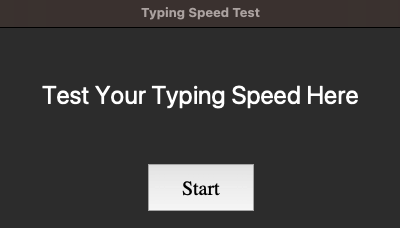
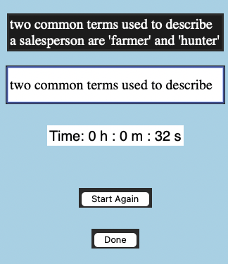
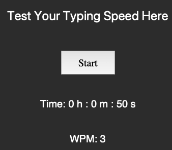

# Typing Speed Test

## Overview

Typing Speed Test is a Python desktop application that allows users to practice their typing skills by typing a randomly selected passage within a timed session.

The application uses Tkinter to provide a graphical user interface and tracks the time taken to complete the typing exercise.

## Features

- **Random Text Selection:** Displays a randomly selected passage for the typing exercise.
- **Typing Practice:** Provides a text input area for users to type the displayed passage.
- **Timer:** Tracks elapsed time during the typing session.
- **Graphical User Interface:** Uses Tkinter to create an interactive desktop application.
- **Typing Performance:** Calculates a typing speed estimate based on the characters typed.

## Technologies Used

- Python 3
- Tkinter
- Random module
- Time-based event handling with Tkinter

## Project Structure

```text
Typing_spped_test/
├── main.py
└── README.md
```

## Requirements

- Python 3
- Tkinter, which is included with many standard Python installations.

No additional third-party packages are required if Tkinter is available in your Python installation.

## How to Run

### 1. Clone the repository

```bash
git clone https://github.com/bhoomipanchal4/Typing_spped_test.git
```

### 2. Navigate to the project directory

```bash
cd Typing_spped_test
```

### 3. Run the application

```bash
python3 main.py
```

## How to Use

1. Launch the application.
2. Read the passage displayed on the screen.
3. Type the passage in the provided text area.
4. Complete the typing exercise while the timer tracks elapsed time.
5. Review the typing performance displayed by the application.

## Screenshots

Add screenshots of the application interface and a completed typing session below.

### Application Interface



### Typing Results



### Showing Word Per Minute Result




**Bhoomi Panchal**

